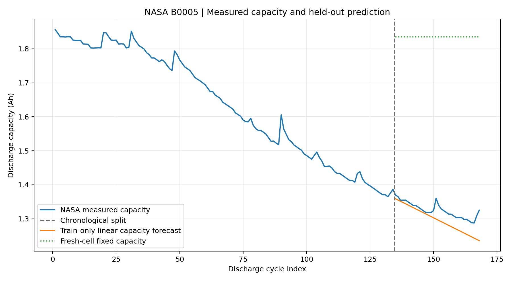
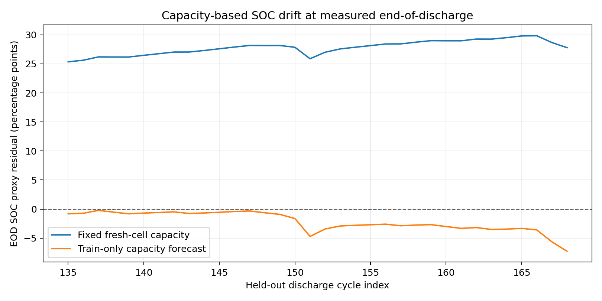

# Li-Ion Battery SOC Estimation & Randles ECM | NASA B0005

**A MATLAB-first, real-data lithium-ion battery modeling project.** It upgrades
a 2.5 Ah illustrative one-RC simulation into a train/test pipeline using NASA
experimental battery-aging observations, with honest capacity-based SOC drift
metrics and an optional full-curve voltage holdout benchmark.

> **Evidence standard:** This repo does **not** validate an SOC estimator against
> its own simulated outputs. It evaluates against measured NASA discharge
> capacities, and (when the original MAT data is provided) recorded terminal
> voltages. NASA does not supply independently instrumented SOC labels, so
> capacity-normalized SOC comparisons are clearly called **proxies**.

## Verified results (capacity observations, not model-simulated voltage)

| Experiment on NASA B0005 | Held-out performance |
|---|---:|
| Real discharge cycles | **168** |
| Chronological train / test split | **134 / 34** |
| Capacity trend MAE (test) | **27.92 mAh** |
| Capacity trend RMSE (test) | **34.84 mAh** |
| Capacity trend MAPE (test) | **2.12%** |
| End-of-discharge SOC proxy MAE, fresh fixed capacity | **27.80 percentage points** |
| End-of-discharge SOC proxy MAE, trend-aware capacity | **2.19 percentage points** |
| Relative improvement in SOC proxy endpoint MAE | **92.1%** |

These numbers were computed by running `scripts/benchmark_capacity.py`
against the **included measured NASA capacity observations**. They are
capacity-calibration / endpoint-drift diagnostics, *not* directly sensed SOC
accuracy, *not* Simulink validation, and *not* experimental voltage RMSE.

### Plots: outputs from the genuine capacity measurements





## Run in two stages

**Stage A — instant, offline, reproducible measured-data benchmark**

```bash
python -m pip install -r requirements.txt
python scripts/benchmark_capacity.py
python -m unittest discover -s tests -v
```

`results/capacity_metrics.json`, `results/capacity_holdout_predictions.csv`
and both PNG plots are regenerated. This stage does not require a MATLAB
license, raw MAT files, or internet access beyond package installation.

**Stage B — full MATLAB Randles ECM vs genuinely held-out voltage curves**

Download the original NASA file automatically:

```bash
python scripts/download_nasa.py
```

If the official mirror blocks access, manually download the NASA **Battery Data
Set** at the primary link in `data/PROVENANCE.md`, find `B0005.mat` inside the
nested NASA battery-aging ZIP files and place it at `data/raw/B0005.mat`.

In MATLAB (R2021b or later, base MATLAB; no Simulink or toolboxes required):

```matlab
cd matlab
capacity_benchmark  % reproduces Stage A numeric metrics using included data
run_project         % fits train-only effective ECM and tests measured voltage
```

Stage B writes measured holdout voltage RMSE/MAE and capacity-normalized SOC
proxy MAE to `results/nasa_voltage_soc_metrics.json`; per-discharge errors and
actual-vs-predicted voltage graphics are saved alongside it. **Stage B has NOT
been executed in the environment used to prepare this repo**, so no voltage
error is claimed. Raw NASA measured data is intentionally excluded from Git.

Optional (illustration only): `demo_synthetic` shows the original 2.5 Ah
setup. Its results do not enter any benchmark.

## What the implementation does

1. **Loads empirical data** from NASA B0005 discharge operations: time,
   terminal voltage, measured current and reported capacity.
2. **Separates training from testing chronologically**, with no validation
   cycles used during parameter fitting.
3. **Calibrates an effective Randles-style one-RC model** using an 11-knot
   SOC/OCV lookup and constrained, regularized nonlinear fitting on training
   I–V traces. It implements exact RC exponential propagation at irregular
   sample times and trapezoidal coulomb counting.
4. **Predicts aging-adjusted capacity** using a 40-cycle training-only linear
   trend; also evaluates a first-10-cycle fixed-capacity baseline.
5. **Measures external errors** on held-out NASA voltage recordings (Stage B)
   and experimentally observed capacity / end-of-discharge SOC proxy (Stage A).

### Equations

```
SOC(t) = clamp(1 - ∫I(t)dt / (3600 Q_est), 0, 1)
dV_RC/dt = -V_RC/(R1 C1) + I/C1
V_terminal = OCV(SOC) - I R0 - V_RC
```

Current is positive for discharge; `Q_est` is predicted **only** from prior
recorded training capacities. No target-cycle measured capacity or voltage is
fed into a test-cycle prediction.

**Important scientific qualification:** The experimental B0005 profiles are
near-constant-current. OCV, R0, R1, and C1 cannot all be uniquely identified
from those curves alone. Fitted values are *regularized effective parameters*,
not independently measured electrochemical resistances. See
[methods](docs/METHODOLOGY.md) for limitations and evaluation definitions.

## Repository layout

```text
li-ion-randles-validation/
├── matlab/
│   ├── run_project.m             # full independent NASA voltage holdout
│   ├── load_nasa_discharge.m     # NASA .mat parser
│   ├── fit_randles.m             # train-only constrained ECM fit
│   ├── simulate_randles.m        # SOC + one-RC model
│   ├── rc_voltage.m              # irregular-step exact RC propagation
│   ├── forecast_capacity.m      # train-only aging trend
│   ├── capacity_benchmark.m      # capacity results in MATLAB
│   └── demo_synthetic.m          # NOT used in any evaluation
├── scripts/
│   ├── benchmark_capacity.py     # executed + checked-in empirical benchmark
│   └── download_nasa.py         # official NASA download/extraction
├── data/
│   ├── processed/B0005_discharge_capacity.csv
│   ├── raw/                     # downloaded data are gitignored
│   └── PROVENANCE.md
├── results/                     # generated CSV, JSON, actual PNGs
├── tests/                       # Python benchmark regression tests
├── docs/
│   ├── METHODOLOGY.md
│   └── RESUME_BULLETS.md
└── .github/workflows/test.yml
```

## Scope and limitations

- **Measured capacity** is not the same as directly measured SOC. The endpoint
  SOC *proxy* uses measured discharged Ah at NASA's cutoff as a reference;
  intermediate proxy SOC is derived by integrating measured current.
- **External voltage validation** is available when the complete raw NASA MAT
  file is downloaded and the MATLAB project is executed; precomputed voltage
  results are intentionally not invented.
- One aging cell, roughly room-temperature, constant-current discharge;
  not yet validated under arbitrary charging protocols, variable load or
  temperature stress.
- OCV here is an effective under-load fitted curve, **not** a true rested OCV.
- NASA's dataset license is not clearly specified on its portal; the MIT
  license covers original repository code, not the source datasets.

## Citation and original source

Saha, B. and Goebel, K. (2007). *Battery Data Set*. NASA Prognostics Data
Repository, NASA Ames Research Center, Moffett Field, California.

[NASA PCoE data repository](https://www.nasa.gov/intelligent-systems-division/discovery-and-systems-health/pcoe/pcoe-data-set-repository/)
|
[Provenance](data/PROVENANCE.md)
|
[Methodology](docs/METHODOLOGY.md)
|
[Resume bullets](docs/RESUME_BULLETS.md)

